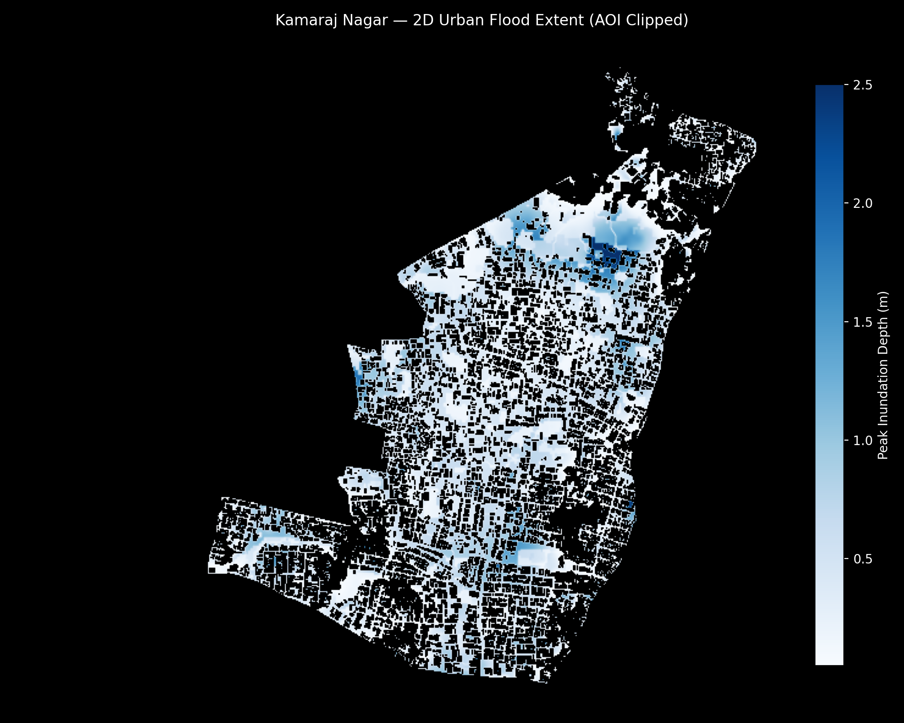

# Kamaraj Nagar 2D Urban Flood Simulator & WebGIS Dashboard

An interactive, high-resolution **2D Hydrodynamic Urban Overland Flow Simulator** and **WebGIS Dashboard** for **Kamaraj Nagar, Puducherry, India**.



## Overview

This project simulates intense precipitation events (such as the Northeast Monsoon cloudbursts in Puducherry) over an urban terrain model using high-performance 2D shallow-water / diffusive-wave hydrodynamics.

- **Study Area**: Kamaraj Nagar, Puducherry, India ($6.73\,\text{km}^2$)
- **Domain Grid**: 548 rows × 491 cols ($5.0\,\text{m}$ spatial resolution, EPSG:32644)
- **Topography**: Stamped DEM ($3.58\,\text{m}$ to $48.70\,\text{m}$), with 3D buildings elevated as physical flow obstructions
- **Roughness**: Spatially distributed Manning's $n$ matrix ($0.015$ to $0.060$)
- **Drainage Network**: 59 active stormwater canals with $30\,\text{mm/hr}$ conveyance capacity
- **Receptor Layer**: 26,236 building structures evaluated for threshold inundation

---

## Key Simulation Findings (85 mm/hr Cloudburst Scenario)

| Metric | Result | Impact |
| :--- | :--- | :--- |
| **Total Inundated Area (>0.05m)** | **266.85 ha** ($2.67\,\text{km}^2$) | Significant street conveyance & depression ponding |
| **Deep Inundation Area (>0.60m)** | **60.99 ha** | Submerged road corridors & natural basins |
| **Total Buildings Evaluated** | **26,236 buildings** | Multi-polygon building footprints |
| **Flooded Buildings (>0.05m)** | **18,307 buildings** (69.8%) | Water in contact with building threshold |
| **High / Severe Risk (>0.60m)** | **4,869 buildings** (18.5%) | Priority evacuation & sandbagging zones |
| **Peak Water Depth** | **13.99 m** | Localized in the lowest topographic depression |

### Building Inundation Breakdown
- 🟢 **Safe / Dry Ground**: 7,929 buildings (30.2%)
- 🔵 **Minor Risk (0.05 - 0.30 m)**: 7,052 buildings (26.9%)
- 🔷 **Moderate Risk (0.30 - 0.60 m)**: 6,386 buildings (24.3%)
- 🟠 **High Risk (0.60 - 1.20 m)**: 4,020 buildings (15.3%)
- 🔴 **Severe Risk (> 1.20 m)**: 849 buildings (3.2%)

---

## WebGIS Interactive Map Features

- **Animated Flood Timeline**: Play and scrub through storm progression ($T = 10, 20, 30, 45, 60, 75, 90, 105, 120\,\text{minutes}$) to observe water surface runoff and drainage outfall.
- **Building Click Inspection**: Click any building marker to inspect ID, ground elevation, height, and peak flood depth.
- **Severity Filtering**: Filter buildings by hazard tier.
- **GIS Overlays**: Toggle 2D flood surface, stormwater canals, and AOI boundary.
- **Multiple Basemaps**: CartoDB Dark, Esri Satellite, OpenStreetMap, and CartoDB Light.

---

## Local Setup

Run the built-in HTTP server:
```bash
python3 -m http.server 8080
```
Open [http://localhost:8080](http://localhost:8080) in your browser.

To re-run or adjust the 2D hydrodynamic simulation:
```bash
python3 run_flood_simulation.py
```

---

## Deploy to Vercel

1. Push this repository to GitHub:
   ```bash
   git init
   git add .
   git commit -m "Initial commit: Kamaraj Nagar Flood Simulator & WebGIS"
   git branch -M main
   git remote add origin https://github.com/<YOUR_USERNAME>/<YOUR_REPO_NAME>.git
   git push -u origin main
   ```
2. In [Vercel](https://vercel.com):
   - Click **Add New** → **Project**.
   - Select your GitHub repository.
   - Leave default settings (Framework Preset: Other / Static) and click **Deploy**.

